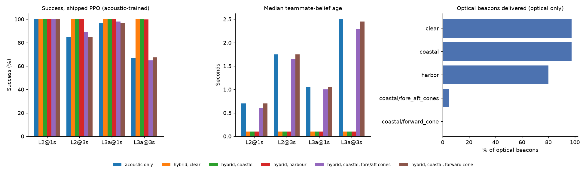

# Optical and hybrid links with the shipped fleet policies (PROJECT_STATUS.md #59)

2026-09-28 · 58,800 episodes · 643 min wall clock, most of it with the Mac asleep (the first run took 21 min) · `python run_optical_study.py` · criteria fixed in advance: [criteria.md](criteria.md)

**Read this first.** The optical model is **uncalibrated**: the water values are rough textbook figures and the delivery curve is a placeholder (50% delivery at 30 m in clear water, ~15 m coastal, ~4 m harbour, when pointed). Every number here is conditional on those assumptions. The policies are the shipped PPO fleet policies, trained on acoustic links only, with no input saying whether the optical link is up (only the teammate-belief age shows it). This study shows whether **fresher teammate information helps existing policies**. It **can't** show whether a fleet learns to stay within optical range and pointed at its teammate: that needs policies trained with `--link hybrid`, the follow-up study (criteria.md, addendum).

What the optical link adds here is **high-rate state sharing**: every tick, the teammate's measured state and the thrust it delivered on that tick. That is not intent sharing (planned commands or a trajectory), which stays open (#48). **No latency effect is modelled:** delivery is quantised to the 0.1 s tick, so optical's 1 ms and acoustic's few ms both arrive on the next tick; the gains below come from send rate and loss.

Hybrid `optical_first` skips a vehicle's acoustic beacon only if an optical message from its teammate arrived on the previous tick (`link_up_ticks` = 1).

**Gate (integration):** 58,800 episodes, 0 bookkeeping failures, every link condition ran with every policy. PASSED.

## 1. Does the optical link help? Hybrid optical_first vs acoustic only, same episodes

| Acoustic condition | Water | Acoustic only | Hybrid | Difference, pts (95% CI) | Verdict | Collisions: hybrid vs acoustic |
|---|---|---|---|---|---|---|
| L2@1s | clear | 100% | 100% | +0 (+0 to +0) | no clear difference | 0% vs 0% |
| L2@3s | clear | 85% | 100% | +15 (+13 to +17) | helps | 0% vs 1% |
| L3a@1s | clear | 97% | 100% | +3 (+2 to +4) | helps | 0% vs 1% |
| L3a@3s | clear | 67% | 100% | +33 (+31 to +36) | helps | 0% vs 3% |
| L2@1s | coastal | 100% | 100% | +0 (+0 to +0) | no clear difference | 0% vs 0% |
| L2@3s | coastal | 85% | 100% | +15 (+13 to +17) | helps | 0% vs 1% |
| L3a@1s | coastal | 97% | 100% | +3 (+2 to +4) | helps | 0% vs 1% |
| L3a@3s | coastal | 67% | 100% | +33 (+31 to +36) | helps | 0% vs 3% |
| L2@1s | harbor | 100% | 100% | +0 (+0 to +0) | no clear difference | 0% vs 0% |
| L2@3s | harbor | 85% | 100% | +15 (+13 to +17) | helps | 0% vs 1% |
| L3a@1s | harbor | 97% | 100% | +3 (+2 to +4) | helps | 0% vs 1% |
| L3a@3s | harbor | 67% | 100% | +33 (+30 to +36) | helps | 0% vs 3% |

Optical only (no acoustic channel), against each acoustic condition:

| Acoustic condition | Water | Acoustic only | Optical only | Difference, pts (95% CI) | Verdict |
|---|---|---|---|---|---|
| L2@1s | clear | 100% | 100% | +0 (+0 to +0) | no clear difference |
| L2@3s | clear | 85% | 100% | +15 (+13 to +17) | helps |
| L3a@1s | clear | 97% | 100% | +3 (+2 to +4) | helps |
| L3a@3s | clear | 67% | 100% | +33 (+31 to +36) | helps |
| L2@1s | coastal | 100% | 100% | +0 (+0 to +0) | no clear difference |
| L2@3s | coastal | 85% | 100% | +15 (+13 to +17) | helps |
| L3a@1s | coastal | 97% | 100% | +3 (+2 to +4) | helps |
| L3a@3s | coastal | 67% | 100% | +33 (+31 to +36) | helps |
| L2@1s | harbor | 100% | 99% | -1 (-1 to -0) | hurts |
| L2@3s | harbor | 85% | 99% | +15 (+12 to +17) | helps |
| L3a@1s | harbor | 97% | 99% | +2 (+2 to +4) | helps |
| L3a@3s | harbor | 67% | 99% | +33 (+30 to +35) | helps |

## 2. Freshness and 3. water

| Condition | Success | Collisions | Optical beacons delivered | Belief updates via optical | Median belief age | Acoustic skipped / episode | Skipped with optical copy lost |
|---|---|---|---|---|---|---|---|
| L2@1s | 100% | 0% | n/a | 0% | 0.70 s | 0.0 | n/a |
| L2@1s hybrid/clear | 100% | 0% | 98% | 100% | 0.10 s | 8.1 | 0% |
| L2@1s hybrid/coastal | 100% | 0% | 97% | 100% | 0.10 s | 8.1 | 0% |
| L2@1s hybrid/harbor | 100% | 0% | 82% | 99% | 0.10 s | 7.1 | 6% |
| L2@3s | 85% | 1% | n/a | 0% | 1.75 s | 0.0 | n/a |
| L2@3s hybrid/clear | 100% | 0% | 98% | 100% | 0.10 s | 2.0 | 0% |
| L2@3s hybrid/coastal | 100% | 0% | 97% | 100% | 0.10 s | 2.0 | 0% |
| L2@3s hybrid/harbor | 100% | 0% | 81% | 100% | 0.10 s | 2.1 | 4% |
| L3a@1s | 97% | 1% | n/a | 0% | 1.05 s | 0.0 | n/a |
| L3a@1s hybrid/clear | 100% | 0% | 98% | 100% | 0.10 s | 8.1 | 0% |
| L3a@1s hybrid/coastal | 100% | 0% | 97% | 100% | 0.10 s | 8.1 | 0% |
| L3a@1s hybrid/harbor | 100% | 0% | 81% | 99% | 0.10 s | 7.2 | 6% |
| L3a@3s | 67% | 3% | n/a | 0% | 2.50 s | 0.0 | n/a |
| L3a@3s hybrid/clear | 100% | 0% | 98% | 100% | 0.10 s | 2.0 | 0% |
| L3a@3s hybrid/coastal | 100% | 0% | 97% | 100% | 0.10 s | 2.0 | 0% |
| L3a@3s hybrid/harbor | 100% | 0% | 80% | 100% | 0.10 s | 2.1 | 4% |
| optical/clear | 100% | 0% | 98% | 100% | 0.10 s | 0.0 | n/a |
| optical/coastal | 100% | 0% | 97% | 100% | 0.10 s | 0.0 | n/a |
| optical/harbor | 99% | 0% | 80% | 100% | 0.10 s | 0.0 | n/a |

## 4. optical_first vs redundant (same episodes)

| Acoustic condition | Water | optical_first | redundant | Redundant − optical_first, pts (95% CI) |
|---|---|---|---|---|
| L2@1s | clear | 100% | 100% | +0 (+0 to +0) |
| L2@1s | coastal | 100% | 100% | +0 (+0 to +0) |
| L2@1s | harbor | 100% | 100% | +0 (+0 to +0) |
| L2@3s | clear | 100% | 100% | +0 (+0 to +0) |
| L2@3s | coastal | 100% | 100% | +0 (+0 to +0) |
| L2@3s | harbor | 100% | 100% | +0 (+0 to +0) |
| L3a@1s | clear | 100% | 100% | +0 (+0 to +0) |
| L3a@1s | coastal | 100% | 100% | +0 (+0 to +0) |
| L3a@1s | harbor | 100% | 100% | +0 (+0 to +0) |
| L3a@3s | clear | 100% | 100% | +0 (+0 to +0) |
| L3a@3s | coastal | 100% | 100% | +0 (+0 to +0) |
| L3a@3s | harbor | 100% | 100% | +0 (+0 to +0) |

Acoustic energy and airtime aren't modelled, so redundant (a superset of messages) can't lose on information; optical_first's value is the acoustic energy and channel time it saves, which matters once three or more vehicles share an acoustic channel.

## 5. What pointing costs (coastal water, cones vs omni, same episodes)

| Terminals | Link | Acoustic condition | Cones | Omni | Cones − omni, pts (95% CI) | Optical delivered with cones |
|---|---|---|---|---|---|---|
| forward_cone | hybrid | L2@1s | 100% | 100% | +0 (+0 to +0) | 0% |
| forward_cone | hybrid | L2@3s | 85% | 100% | -15 (-17 to -13) | 0% |
| forward_cone | hybrid | L3a@1s | 97% | 100% | -3 (-4 to -2) | 0% |
| forward_cone | hybrid | L3a@3s | 68% | 100% | -32 (-35 to -30) | 0% |
| forward_cone | optical | none | 12% | 100% | -88 (-89 to -86) | 0% |
| fore_aft_cones | hybrid | L2@1s | 100% | 100% | +0 (+0 to +0) | 7% |
| fore_aft_cones | hybrid | L2@3s | 89% | 100% | -11 (-13 to -9) | 5% |
| fore_aft_cones | hybrid | L3a@1s | 98% | 100% | -2 (-3 to -1) | 5% |
| fore_aft_cones | hybrid | L3a@3s | 65% | 100% | -35 (-38 to -32) | 5% |
| fore_aft_cones | optical | none | 34% | 100% | -66 (-69 to -64) | 5% |

## 6. Collisions: does any link raise them? (vs acoustic only, same episodes)

**Yes.** These link conditions collide significantly more often than acoustic only (paired 95% CI above zero):

| Link | Acoustic condition | Mode | Collisions with link | Acoustic only | Difference, pts (95% CI) |
|---|---|---|---|---|---|
| `hybrid/coastal/fore_aft_cones` | L2@3s | clean | 3% | 1% | +2 (+0 to +3) |
| `hybrid/coastal/fore_aft_cones` | L3a@3s | clean | 12% | 3% | +9 (+7 to +11) |
| `optical/coastal/fore_aft_cones` | L2@1s | clean | 32% | 0% | +32 (+30 to +35) |
| `optical/coastal/fore_aft_cones` | L2@3s | clean | 32% | 1% | +31 (+28 to +34) |
| `optical/coastal/fore_aft_cones` | L3a@1s | clean | 32% | 1% | +32 (+29 to +35) |
| `optical/coastal/fore_aft_cones` | L3a@3s | clean | 32% | 3% | +29 (+27 to +32) |

**What happens:** the vehicles start lined up, inside each other's cones, so the first optical beacon arrives within 0.2 s, far sooner than the first acoustic one. The policy starts closing on that fix, rolls and yaws the vehicles out of the cones, and the link goes quiet. Over 80 of these episodes (L3a @ 3 s, last_beacon, seed-1 policy), every collision happened with a teammate belief 4.6-7.7 s old; acoustic only collided in none of them. An intermittent high-rate link is worse than a slow steady one for a policy that never learned to keep it up. Omni terminals never raise collisions here.

## 7. Noisy mode: hybrid (coastal, omni) vs acoustic, sensor noise + roll/pitch disturbance on

| Acoustic condition | Acoustic only | Hybrid | Difference, pts (95% CI) | Verdict |
|---|---|---|---|---|
| L2@1s | 90% | 94% | +4 (+3 to +6) | helps |
| L2@3s | 71% | 94% | +23 (+21 to +26) | helps |
| L3a@1s | 81% | 94% | +14 (+11 to +16) | helps |
| L3a@3s | 56% | 94% | +38 (+35 to +41) | helps |

## Limits

- Uncalibrated optical model (above). A lab's link logs (success against range and angle) are what would calibrate it; UNH's thesis gives one data point (about 20 m, 5 kbps, 3 nodes).
- Pointing is judged on the true attitude with a hard cone. The shipped policies roll and pitch freely (#50), which is why narrow cones deliver little here, and why an early fix followed by silence can end in a collision (section 6).
- No occlusion, sunlight, bubbles or changing turbidity. Two vehicles, so no shared acoustic channel.
- Policies trained on acoustic links only. Whether a policy trained with a hybrid link learns to stay within optical range and pointed at its teammate, and what that costs in collisions, is the next study (`strathe train-fleet --link hybrid`).
