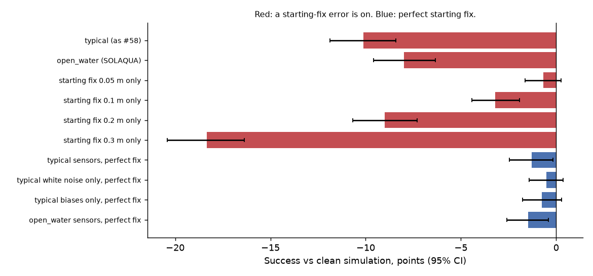

# What part of sensor noise costs formation-holding? (PROJECT_STATUS.md #60)

2026-10-01 · 26,400 paired episodes · 18 min · `python run_noise_decomposition.py`

**Exploratory follow-up to the noise study (#58), not a study with criteria fixed in advance.** It was run after a quick check showed every mix of the `typical` sensors costing the same 10 points. Each row switches on one part of the sensor model on the same episodes: shipped PPO seeds 1-3, beliefs calibrated and last_beacon, L2 @ 1 s and L3a @ 3 s, the standard start grid with 5 packet-loss seeds.

| Variant | Success | Noise − clean, pts (95% CI) | Mean navigation error |
|---|---|---|---|
| clean | 83% | — | 0 cm |
| typical (as #58) | 73% | -10 (-12 to -8) | 26 cm |
| open_water (SOLAQUA) | 75% | -8 (-10 to -6) | 22 cm |
| starting fix 0.05 m only | 83% | -1 (-2 to +0) | 6 cm |
| starting fix 0.1 m only | 80% | -3 (-4 to -2) | 13 cm |
| starting fix 0.2 m only | 74% | -9 (-11 to -7) | 25 cm |
| starting fix 0.3 m only | 65% | -18 (-20 to -16) | 38 cm |
| typical sensors, perfect fix | 82% | -1 (-2 to -0) | 4 cm |
| typical white noise only, perfect fix | 83% | -0 (-1 to +0) | 2 cm |
| typical biases only, perfect fix | 83% | -1 (-2 to +0) | 3 cm |
| open_water sensors, perfect fix | 82% | -1 (-3 to -0) | 3 cm |

## What it shows

- **The starting position fix is the cost.** A 0.2 m starting-fix error with perfect sensors costs -9 (-11 to -7) points; the `typical` sensors with a perfect fix cost -1 (-2 to -0). Each vehicle's fix error is independent, so the relative position error is about 1.4 times larger, against a ±0.2 m formation tolerance; over a 20 s episode, dead-reckoning drift barely builds up.
- **The noise study's (#58) explanation was wrong.** It said realistic sensors cost 10 points through dead-reckoning drift. The 10 points are real, but they come from the 0.2 m starting fix inside the `typical` preset, not from the sensors or their drift.
- **Measured open-water sensors (SOLAQUA) cost nothing on their own** (-1 (-3 to -0)); with the measured USBL starting fix (0.17 m) they cost -8 (-10 to -6), close to `typical` because the assumed 0.2 m fix was about right.
- **What to do with it:** report the starting-fix error with any noisy result, set it to your positioning's accuracy (`--start-fix-error`), and treat relative positioning between the vehicles (acoustic ranging, a shared USBL) as the lever.

