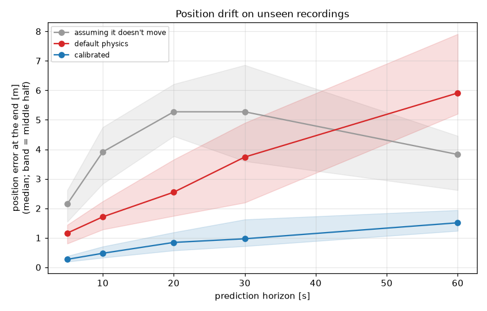
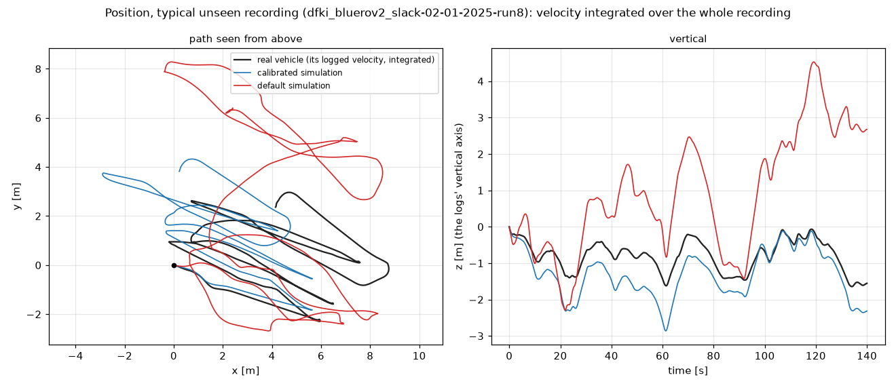
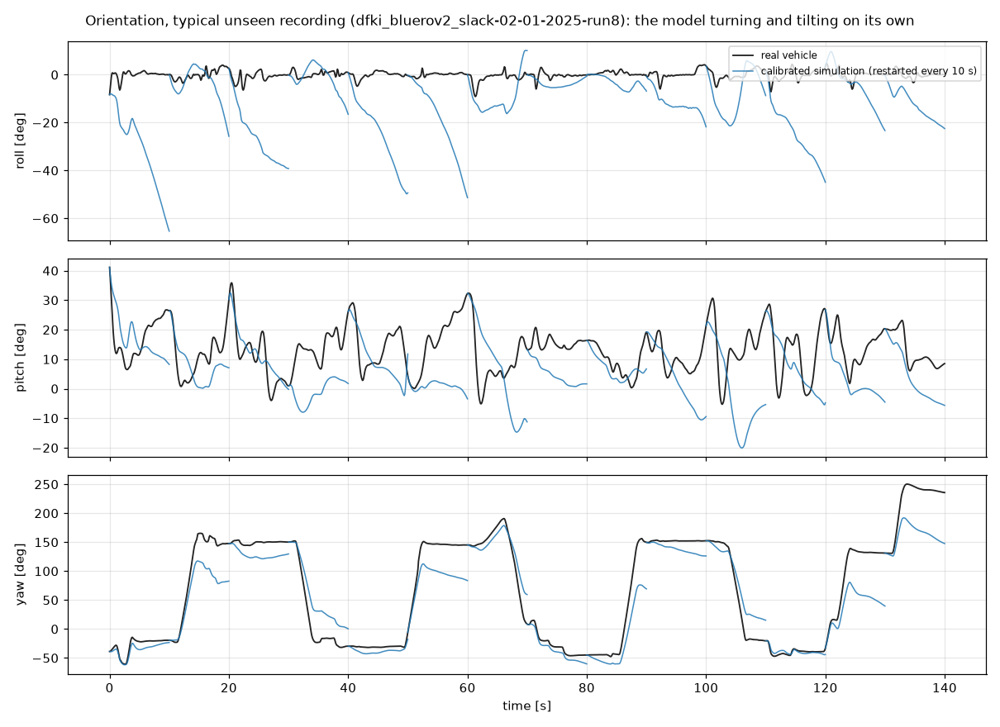
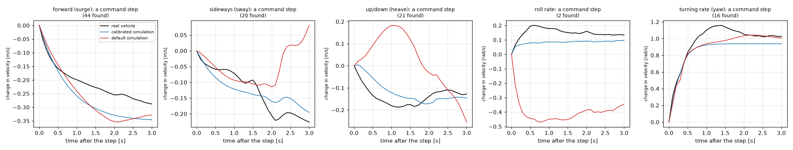
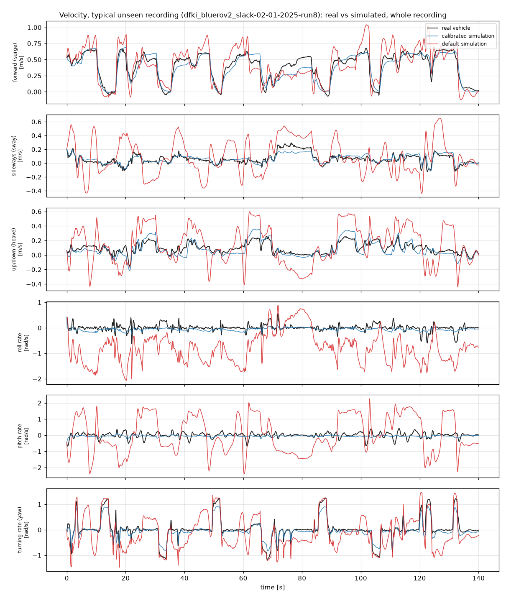

# Calibration report: calibration_output_dfki_bluerov2_slack

2026-10-06

## Bottom line

It is trustworthy for **0 of 6** motion axes. On recording sessions the calibration never saw, it predicts 5 of 6 axes better than simply assuming no motion (skill, where 1 is perfect: forward speed (surge) +0.80, sideways speed (sway) +0.61, turning rate (yaw) +0.56, up/down speed (heave) +0.45, pitch rate +0.01); on the other 1 it does no better. Beating the default model alone can flatter a poor default, so each verdict below checks both.

## Can I trust it for this motion?

| Motion | Verdict | Why |
|---|---|---|
| forward speed (surge) | ⚠️ Use with care | it relies on forward drag (slow speeds), water carried along when accelerating forward which hit their allowed limits or look physically implausible |
| sideways speed (sway) | ⚠️ Use with care | it relies on sideways drag (slow speeds) which hit their allowed limits or look physically implausible |
| up/down speed (heave) | ⚠️ Use with care | it relies on vertical drag (fast speeds) which hit their allowed limits or look physically implausible |
| roll rate | ❌ Don't rely on it | it predicts this motion no better than simply assuming the vehicle isn't moving on this axis (skill -0.25), even though it is 88% better than the default model |
| pitch rate | ⚠️ Use with care | it only partly predicts this motion (skill +0.01; 1 = perfect, 0 = no better than assuming no motion); it relies on resistance to pitching, pitch damping (fast rates) which hit their allowed limits or look physically implausible |
| turning rate (yaw) | ⚠️ Use with care | it relies on turning damping (fast rates) which hit their allowed limits or look physically implausible |

## Did it learn the vehicle, or just memorise the training runs?

Can't tell from these sessions: the error on unseen sessions is lower than on the training runs, which usually means the unseen sessions were easier (gentler, or recorded in different conditions), not that the model learned more. Hold out sessions like the ones you'll simulate. (Unseen / training error, median over the six axes: 0.85; about 1 is what you want.)

## How the simulation compares with the real vehicle

On the 8 recordings the calibration never saw (02-01-2025). The numbers are in `validation/validation.json`.

**Position.** How far the simulated vehicle ends up from where its logged velocity says it went, starting each window from the real state. Median over the windows (90% of windows under the second number):

| After | Calibrated | Default physics | Assuming it doesn't move |
|---|---|---|---|
| 10 s | 0.48 m (0.91 m) | 1.71 m | 3.91 m |
| 30 s | 0.97 m (1.95 m) | 3.74 m | 5.27 m |
| 60 s | 1.51 m (3.66 m) | 5.91 m | 3.83 m |

**Orientation, with the model turning and tilting on its own** (the fit itself is scored with the logged orientation fed in). Median error after 3 s and 10 s, restarting from the real state every 10 s:

| Angle | Calibrated | Default physics | Holding the starting attitude |
|---|---|---|---|
| Roll | 13.8° / 34.9° | 29.5° / 26.9° | 1.1° / 1.4° |
| Pitch | 8.1° / 19.2° | 16.2° / 14.8° | 9.0° / 8.2° |
| Yaw | 8.5° / 26.3° | 109.2° / 99.4° | 15.7° / 78.8° |

- **Yaw:** the simulation tracks the real vehicle better than holding the starting attitude.
- **Roll, pitch:** worse than simply holding the starting attitude. Don't trust the simulated roll and pitch on their own (LIMITS.md).

**Response over 1 s.** The velocity change over the next second (that is, the average acceleration), predicted against measured, from 1019 moments. Skill compares with assuming the velocity stays the same (1 = perfect, 0 = no better):

| Motion | Calibrated error | Default physics | Velocity stays the same | Skill |
|---|---|---|---|---|
| forward speed (surge) | 0.061 | 0.177 | 0.112 | +0.45 |
| sideways speed (sway) | 0.033 | 0.182 | 0.059 | +0.45 |
| up/down speed (heave) | 0.068 | 0.252 | 0.068 | +0.01 |
| roll rate | 0.141 | 1.102 | 0.177 | +0.20 |
| pitch rate | 0.181 | 1.344 | 0.281 | +0.36 |
| turning rate (yaw) | 0.158 | 0.442 | 0.412 | +0.62 |

Errors in m/s (surge, sway, heave) and rad/s (roll, pitch, turning).

**Command steps.** When a force or torque jumps and then holds: how long the velocity takes to make 63% of its change, and how big the change is, model against real (medians):

| Motion | Steps | Real vehicle | Calibrated | Calibrated size / real |
|---|---|---|---|---|
| forward speed (surge) | 44 | 0.9 s | 0.8 s | 0.95 |
| sideways speed (sway) | 20 | 0.9 s | 0.6 s | 0.92 |
| up/down speed (heave) | 21 | 0.3 s | 0.8 s | 1.58 |
| roll rate | 2 | 0.2 s | 0.2 s | 0.80 |
| turning rate (yaw) | 16 | 0.4 s | 0.3 s | 1.01 |

**Velocity over whole recordings**, as the calibration is scored: [typical](validation/velocity_typical.png), [best](validation/velocity_best.png), [worst](validation/velocity_worst.png).

## Be careful with

**Values stuck at a limit (10).** The fit pushed these as far as allowed and stopped, so the true value is probably beyond the limit:

- resistance to rolling (inertia + added inertia) (`Ieff_roll` = 0.265, at its upper limit of [0.255, 0.265])
- resistance to pitching (`Ieff_pitch` = 0.235, at its upper limit of [0.225, 0.235])
- forward drag (slow speeds) (`Xu` = -50, at its lower limit of [-50.0, -1.0])
- sideways drag (slow speeds) (`Yv` = -80, at its lower limit of [-80.0, -1.6])
- roll damping (`Kp` = -10, at its lower limit of [-10.0, -0.1])
- vertical drag (fast speeds) (`Zww` = -3, at its upper limit of [-150.0, -3.0])
- roll damping (fast rates) (`Kpp` = -10, at its lower limit of [-10.0, -0.2])
- pitch damping (fast rates) (`Mqq` = -0.2, at its upper limit of [-10.0, -0.2])
- turning damping (fast rates) (`Nrr` = -0.4, at its upper limit of [-30.0, -0.4])
- water carried along when accelerating forward (`Xu_dot` = 30, at its upper limit of [0.0, 30.0])

**Parameters your data can't tell apart.** In these pairs, raising one and lowering the other gives almost the same motion, so the data pins down their combined effect but not each value:

- water carried along when accelerating forward vs water carried along vertically (correlation +0.99)
- forward drag (slow speeds) vs forward drag (fast speeds) (correlation -0.98)
- vertical drag (slow speeds) vs vertical drag (fast speeds) (correlation -0.96)
- resistance to pitching vs surge-pitch coupling (correlation -0.95)
- self-righting (centre of gravity below buoyancy) vs surge-pitch coupling (correlation -0.94)
- pitch damping vs surge-pitch coupling (correlation +0.93)
- roll damping vs roll damping (fast rates) (correlation -0.92)
- pitch damping vs self-righting (centre of gravity below buoyancy) (correlation -0.91)
- resistance to pitching vs self-righting (centre of gravity below buoyancy) (correlation +0.91)
- turning damping vs turning damping (fast rates) (correlation -0.91)
- water carried along when accelerating forward vs water carried along sideways (correlation +0.89)
- resistance to pitching vs pitch damping (correlation -0.88)
- water carried along sideways vs water carried along vertically (correlation +0.88)
- sideways drag (slow speeds) vs sideways drag (fast speeds) (correlation -0.85)

**Groups of values your data barely pins down.** Each group below can shift together with almost no change in the predicted motion, so treat the individual values as uncertain even where they look precise:

- resistance to rolling (inertia + added inertia) (constrained about 32,631x less than the best-constrained combination)
- resistance to pitching (constrained about 6,893x less than the best-constrained combination)

## What to do next

1. Your logs don't explain roll rate: that motion isn't caused by the recorded thruster commands (tether pull, waves or contact are common causes). To calibrate it, record tests where the thrusters cause it: tip the vehicle and let it settle (a free-decay test), and command deliberate roll/pitch moves, with the tether slack. Until then, treat the simulator's values for those motions as reference values, not measurements.
2. Record more manoeuvres that exercise pitch rate: short, sharp, varied commands on those axes, in several separate sessions.
3. 10 parameter(s) stopped at the edge of their allowed range. Review those limits in vehicle_spec.yaml with someone who knows the vehicle; if the physics allows, widen them and re-run. Until then treat those values as 'at least this large', not as measurements.
4. Some parameters can trade off against each other (listed above). That's harmless for simulation, but don't report those individual values as vehicle properties. Manoeuvres that move the axes they belong to in different ways (different speeds, and turning while moving) are what separate them.
5. Validate on hardware: run the same commands on the real vehicle and in the calibrated simulator and compare. Held-out logs are strong evidence; a live test is the real proof.

## Technical appendix

Held-out RMSE per axis (m/s or rad/s): predicting no motion, default physics, calibrated physics. Skill = 1 - calibrated / no-motion.

| Axis | No motion | Default | Calibrated | Improvement vs default | Skill |
|---|---|---|---|---|---|
| u | 0.3917 | 0.1499 | 0.0802 | +46.5% | +0.80 |
| v | 0.0858 | 0.2218 | 0.0332 | +85.1% | +0.61 |
| w | 0.1281 | 0.2057 | 0.0699 | +66.0% | +0.45 |
| p | 0.1086 | 1.1018 | 0.1356 | +87.7% | -0.25 |
| q | 0.1643 | 1.0804 | 0.1624 | +85.0% | +0.01 |
| r | 0.3431 | 0.4442 | 0.1514 | +65.9% | +0.56 |

Identifiability: Jacobian condition number 3.26e+04 from 49 training runs, 22 free parameters, same objective as the fit.
