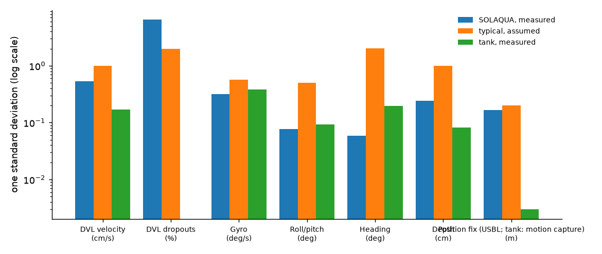

# Open-water sensor noise from SOLAQUA (PROJECT_STATUS.md #60)

2026-10-01 · 58 in-water recordings · `python fit_solaqua_noise.py` · preset: `sensor_noise/open_water_bluerov2_solaqua.yaml` (`--noise open_water`)

Data: SOLAQUA by SINTEF Ocean, a BlueROV2 at a full-scale fish farm in Norway ([https://data.sintef.no/feature/fe-a8f86232-5107-495e-a3dd-a86460eebef6](https://data.sintef.no/feature/fe-a8f86232-5107-495e-a3dd-a86460eebef6), CC BY-SA 4.0). Derived statistics shared under the same licence.

## Measured against what Strathe assumed

| Sensor | SOLAQUA (measured) | `typical` (assumed) | `tank` (measured, reference tank) |
|---|---|---|---|
| DVL velocity | 0.535 cm/s | 1 cm/s | 0.169 cm/s |
| DVL dropouts | 6.5 % | 2 % | 0 % |
| Gyro | 0.317 deg/s | 0.573 deg/s | 0.386 deg/s |
| Roll/pitch | 0.0768 deg | 0.498 deg | 0.0936 deg |
| Heading | 0.0587 deg | 2.01 deg | 0.195 deg |
| Depth | 0.242 cm | 1 cm | 0.0824 cm |
| Position fix (USBL; tank: motion capture) | 0.167 m | 0.2 m | 0.00297 m |

- Per axis: DVL 0.68, 0.64, 0.29 cm/s (u, v, w); gyro 0.38, 0.27, 0.3 deg/s; roll, pitch 0.089, 0.065 deg.
- Native rates: DVL 9.4 Hz, attitude/gyro 16.7 Hz, depth 16.2 Hz, USBL 0.5 Hz. Each was measured at its own rate (not resampled).
- USBL fix error 0.17 m per axis, from 58 recordings (short windows fitted to DVL dead reckoning); the USBL's own reported sigma is 0.1 m.

## What this data can't tell, and what the preset does instead

- **Biases and dead-reckoning drift.** The DVL tracked the fish-farm net at about 1.02 m, and the net moves with the current (0.04-0.2 m/s on the day), while the USBL measures against the earth. Their disagreement is mostly the net moving, not a sensor bias, so the preset keeps `typical`'s ASSUMED biases (`assumed_fields` in the file says which).
- **Short-range DVL.** A DVL at 0.5-2 m is quieter than one bottom-locked at 10-50 m.
- **Filtered attitude.** Gyro, roll/pitch and heading are ArduSub's estimates, which is what a policy reading ArduSub sees, not raw IMU noise.
- **No thruster forces.** `/commanded_thrust` holds ArduSub pilot-input channels, so SOLAQUA can't calibrate the physics.

