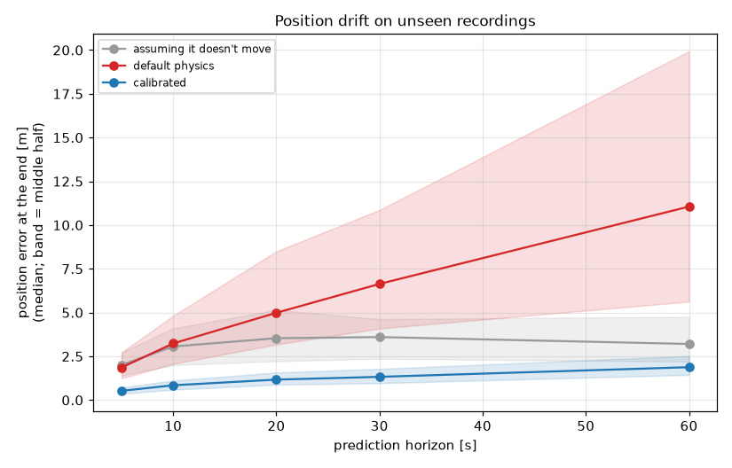
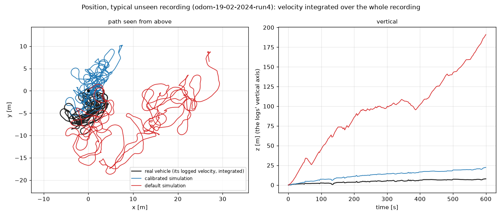
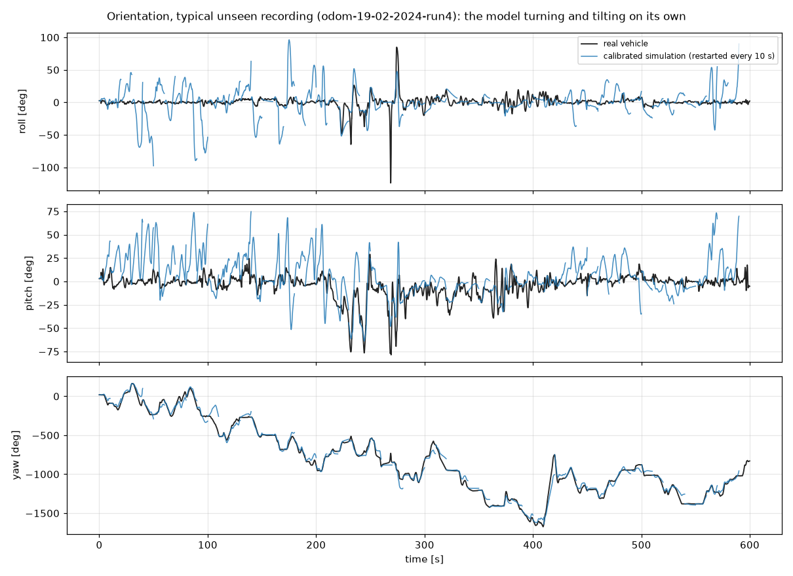
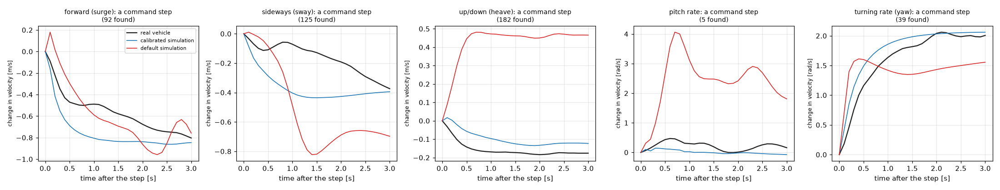
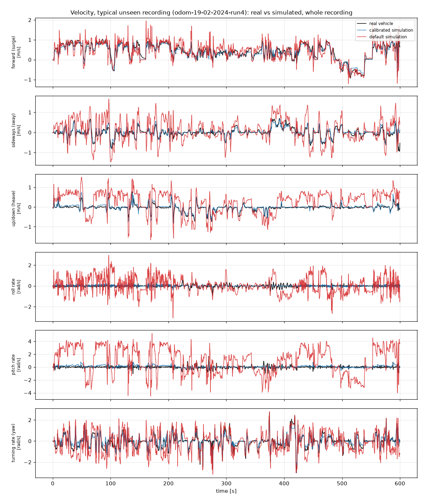

# Calibration report: calibration_output_armfix

2026-10-06

## Bottom line

It is trustworthy for **1 of 6** motion axes: turning rate (yaw). On recording sessions the calibration never saw, it predicts 4 of 6 axes better than simply assuming no motion (skill, where 1 is perfect: forward speed (surge) +0.72, up/down speed (heave) +0.59, turning rate (yaw) +0.58, sideways speed (sway) +0.51); on the other 2 it does no better. Beating the default model alone can flatter a poor default, so each verdict below checks both.

## Can I trust it for this motion?

| Motion | Verdict | Why |
|---|---|---|
| forward speed (surge) | ⚠️ Use with care | it relies on forward drag (slow speeds), forward drag (fast speeds) which hit their allowed limits or look physically implausible |
| sideways speed (sway) | ⚠️ Use with care | it relies on sideways drag (slow speeds), sideways drag (fast speeds) which hit their allowed limits or look physically implausible |
| up/down speed (heave) | ⚠️ Use with care | it relies on vertical drag (slow speeds), vertical drag (fast speeds), net buoyancy (float vs sink) which hit their allowed limits or look physically implausible |
| roll rate | ❌ Don't rely on it | it predicts this motion no better than simply assuming the vehicle isn't moving on this axis (skill -0.03), even though it is 79% better than the default model |
| pitch rate | ❌ Don't rely on it | it predicts this motion no better than simply assuming the vehicle isn't moving on this axis (skill -0.10), even though it is 88% better than the default model |
| turning rate (yaw) | ✅ Trust it | it predicts this motion well on unseen sessions (skill +0.58; 1 = perfect) and 53% more accurately than the default model |

> ⚠️ The optimizer stopped before fully converging. The result is usable but may improve with a longer run.

## Did it learn the vehicle, or just memorise the training runs?

No sign of memorising: the error on unseen sessions is about the same as on the training runs. (Unseen / training error, median over the six axes: 0.98; about 1 is what you want.)

## How the simulation compares with the real vehicle

On the 14 recordings the calibration never saw (16-02-2024, 19-02-2024). The numbers are in `validation/validation.json`.

**Position.** How far the simulated vehicle ends up from where its logged velocity says it went, starting each window from the real state. Median over the windows (90% of windows under the second number):

| After | Calibrated | Default physics | Assuming it doesn't move |
|---|---|---|---|
| 10 s | 0.84 m (1.39 m) | 3.23 m | 3.06 m |
| 30 s | 1.33 m (2.33 m) | 6.64 m | 3.60 m |
| 60 s | 1.88 m (3.22 m) | 11.06 m | 3.21 m |

**Orientation, with the model turning and tilting on its own** (the fit itself is scored with the logged orientation fed in). Median error after 3 s and 10 s, restarting from the real state every 10 s:

| Angle | Calibrated | Default physics | Holding the starting attitude |
|---|---|---|---|
| Roll | 5.3° / 8.7° | 18.1° / 20.1° | 2.8° / 3.8° |
| Pitch | 8.9° / 10.7° | 19.2° / 17.4° | 4.7° / 6.3° |
| Yaw | 17.3° / 42.9° | 53.9° / 81.6° | 37.5° / 95.4° |

- **Yaw:** the simulation tracks the real vehicle better than holding the starting attitude.
- **Roll, pitch:** worse than simply holding the starting attitude. Don't trust the simulated roll and pitch on their own (LIMITS.md).

**Response over 1 s.** The velocity change over the next second (that is, the average acceleration), predicted against measured, from 7943 moments. Skill compares with assuming the velocity stays the same (1 = perfect, 0 = no better):

| Motion | Calibrated error | Default physics | Velocity stays the same | Skill |
|---|---|---|---|---|
| forward speed (surge) | 0.131 | 0.275 | 0.161 | +0.18 |
| sideways speed (sway) | 0.097 | 0.382 | 0.129 | +0.25 |
| up/down speed (heave) | 0.076 | 0.451 | 0.138 | +0.45 |
| roll rate | 0.147 | 0.688 | 0.186 | +0.21 |
| pitch rate | 0.220 | 1.798 | 0.290 | +0.24 |
| turning rate (yaw) | 0.235 | 0.547 | 0.625 | +0.62 |

Errors in m/s (surge, sway, heave) and rad/s (roll, pitch, turning).

**Command steps.** When a force or torque jumps and then holds: how long the velocity takes to make 63% of its change, and how big the change is, model against real (medians):

| Motion | Steps | Real vehicle | Calibrated | Calibrated size / real |
|---|---|---|---|---|
| forward speed (surge) | 92 | 0.6 s | 0.3 s | 1.03 |
| sideways speed (sway) | 125 | 0.5 s | 0.3 s | 0.98 |
| up/down speed (heave) | 182 | 0.6 s | 0.4 s | 0.97 |
| pitch rate | 5 | 0.4 s | 0.1 s | 1.06 |
| turning rate (yaw) | 39 | 0.5 s | 0.5 s | 1.08 |

- **The simulated vehicle responds faster than the real one:** at least 1.5 times as fast on 3 of 5 axes. Thruster spin-up and command lag aren't modelled (LIMITS.md); a controller tuned in simulation may be too aggressive on the real vehicle.

**Velocity over whole recordings**, as the calibration is scored: [typical](validation/velocity_typical.png), [best](validation/velocity_best.png), [worst](validation/velocity_worst.png).

## Be careful with

**Values stuck at a limit (14).** The fit pushed these as far as allowed and stopped, so the true value is probably beyond the limit:

- resistance to rolling (inertia + added inertia) (`Ieff_roll` = 0.265, at its upper limit of [0.255, 0.265])
- resistance to pitching (`Ieff_pitch` = 0.235, at its upper limit of [0.225, 0.235])
- forward drag (slow speeds) (`Xu` = -50, at its lower limit of [-50.0, -1.0])
- sideways drag (slow speeds) (`Yv` = -80, at its lower limit of [-80.0, -1.6])
- vertical drag (slow speeds) (`Zw` = -100, at its lower limit of [-100.0, -2.0])
- roll damping (`Kp` = -10, at its lower limit of [-10.0, -0.1])
- pitch damping (`Mq` = -5, at its lower limit of [-5.0, -0.1])
- forward drag (fast speeds) (`Xuu` = -100, at its lower limit of [-100.0, -2.0])
- sideways drag (fast speeds) (`Yvv` = -100, at its lower limit of [-100.0, -2.0])
- vertical drag (fast speeds) (`Zww` = -150, at its lower limit of [-150.0, -3.0])
- roll damping (fast rates) (`Kpp` = -10, at its lower limit of [-10.0, -0.2])
- pitch damping (fast rates) (`Mqq` = -10, at its lower limit of [-10.0, -0.2])
- net buoyancy (float vs sink) (`net_buoyancy_z` = 1, at its upper limit of [-1.0, 1.0])
- surge-pitch coupling (`Xq_dot` = 0.5, at its upper limit of [-0.5, 0.5])

## What to do next

1. Your logs don't explain roll rate, pitch rate: that motion isn't caused by the recorded thruster commands (tether pull, waves or contact are common causes). To calibrate it, record tests where the thrusters cause it: tip the vehicle and let it settle (a free-decay test), and command deliberate roll/pitch moves, with the tether slack. Until then, treat the simulator's values for those motions as reference values, not measurements.
2. 14 parameter(s) stopped at the edge of their allowed range. Review those limits in vehicle_spec.yaml with someone who knows the vehicle; if the physics allows, widen them and re-run. Until then treat those values as 'at least this large', not as measurements.
3. Validate on hardware: run the same commands on the real vehicle and in the calibrated simulator and compare. Held-out logs are strong evidence; a live test is the real proof.

## Technical appendix

Held-out RMSE per axis (m/s or rad/s): predicting no motion, default physics, calibrated physics. Skill = 1 - calibrated / no-motion.

| Axis | No motion | Default | Calibrated | Improvement vs default | Skill |
|---|---|---|---|---|---|
| u | 0.4829 | 0.2299 | 0.1340 | +41.7% | +0.72 |
| v | 0.1994 | 0.3397 | 0.0980 | +71.1% | +0.51 |
| w | 0.1860 | 0.4506 | 0.0762 | +83.1% | +0.59 |
| p | 0.1391 | 0.6671 | 0.1426 | +78.6% | -0.03 |
| q | 0.1995 | 1.7845 | 0.2201 | +87.7% | -0.10 |
| r | 0.5803 | 0.5153 | 0.2430 | +52.8% | +0.58 |
